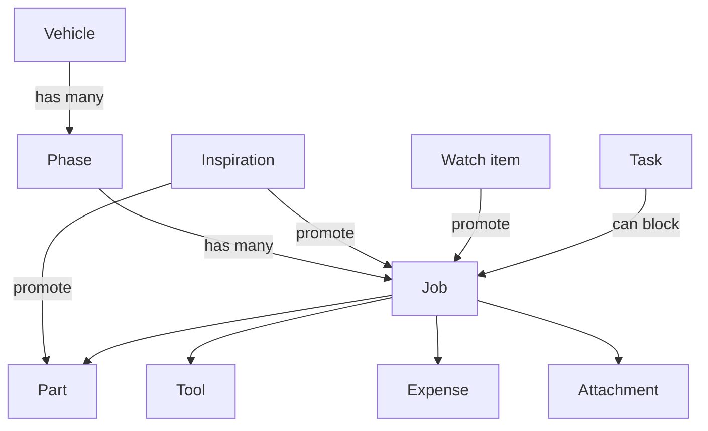

# Cayenne Project Tracker — Product Spec

Oct 9, 2026 · Travis Roberson

## Overview

A single-user web app that plans, tracks, and documents the 2004 Porsche 955 Cayenne Turbo overland build: phases, jobs, parts, tools, costs, and inspiration in one connected system rather than three separate lists.

**User:** Travis, as the sole owner and builder. No sharing, roles, or multi-tenant concerns in MVP.

**Goals**

- Know at any moment what each phase has cost versus its budget, and what is still committed but unpaid.
- Never double-enter a part: one record follows it from idea to installed.
- Know what has to happen (parts, tools, prior jobs) before a job can start.
- Produce a credible, mileage-stamped service history for resale.
- Capture a job from a phone in the garage in under 30 seconds.

**Success looks like:** after three months of use, the tracker answers "what did Phase 2 cost," "what's blocking the armor install," and "when was the transfer case fluid last changed" in under 10 seconds each, with no spreadsheet on the side.

## Scope

MVP covers the original three areas, restructured around a shared Job model, plus the structural fixes from the review. Everything that adds delight but not core tracking is deferred.

| Area | MVP | Post-MVP |
| --- | --- | --- |
| Vehicle | One vehicle record; every entity carries vehicle_id | Multi-vehicle switcher (911, SVR, WaveRunner) |
| Plan | Phases, jobs, status, blocked-by links, budgets | Drawn timeline / dependency graph |
| Work Log | Completed jobs with type, date, odometer, notes, photos | Recurring maintenance schedules and reminders |
| Watch list | Concerns with follow-up by date and/or mileage, check-in history, promote to job; due items on dashboard | Email or push reminders when due |
| Tasks | Errands and logistics with optional due date and links to a job, part, phase, or watch item; can block a job | Recurring tasks, calendar sync for appointments |
| Parts | Lifecycle object with OEM/aftermarket numbers, vendor, cost, fitment notes | Weight/payload tracking against GVWR |
| Tools | Inventory with status, storage location, cost, linked to jobs | Tool amortization per job |
| Inspiration | Photo and URL capture, tags, promote to part or job | Auto-pulled link previews from Instagram/YouTube |
| Gallery | All photos and clips on one timeline, filters, highlights-only progress view, full-screen carousel | Before/after compare slider, auto slideshow or time-lapse export |
| Costs | Budget vs. committed vs. actual by phase and job; labor; sell-back | Receipt OCR, email forwarding |
| Capture | Responsive web, phone camera and audio/video upload | Offline mode, installable PWA polish |
| Exports | Service history PDF, build sheet PDF, Excel/CSV of everything | Public read-only build page |
| Reference | Free-form notes on the vehicle record | Structured spec sheet (fluids, torque, pressures) |

**Non-goals:** multiple users or sharing, shop/customer workflows, parts price comparison, integration with vendor carts or OBD data.

## Core model

The Job is the center of the app: a planned job lives in the Plan, and the same record, once marked Done, is the Work Log entry. That removes the duplication between the original Maintenance Log and Project Plan.

Vehicle → Phase → Job is the spine; Phase is optional for routine maintenance jobs. Parts, Tools, Expenses, and Attachments link to Jobs, but Expenses can also link straight to a Phase and Attachments can hang off any record. Inspiration promotes into either a Part or a Job. Watch items are the intake for concerns rather than wants: they sit outside the plan with their own follow-up dates until promoted to a Job. Tasks are the errands around the build; they can link to any record and can block a Job.

## Entity specs

Ten entities. Money lives in one ledger (Expense) so every total is a sum over one table; Attachments can hang off anything.

### Vehicle

| Field | Notes |
| --- | --- |
| Name, year, model, generation | "2004 Cayenne Turbo", 955 |
| VIN | Optional |
| Current odometer | Updated whenever a job logs a higher reading |
| Purchase date, purchase price | Baseline for total investment |
| Notes | Free-form reference (fluids, torque specs) until the spec sheet ships |

### Phase

| Field | Notes |
| --- | --- |
| Name, description, order | e.g. "1. Baseline maintenance," "2. Suspension and tires" |
| Status | Planned · Active · Done |
| Budget | Planned spend for the phase |
| Target dates | Optional start and finish |

A new vehicle starts with five seeded phases (see Decisions). They're ordinary records: rename, reorder, add, or delete freely.

### Job

The unit of work. A planned job lives in the Plan; a done job is the Work Log entry. No separate log record.

| Field | Notes |
| --- | --- |
| Title, description | "Install 2in lift spacers + alignment" |
| Phase | Optional; unphased jobs are allowed for routine maintenance |
| Type | Maintenance · Repair · Modification · Diagnosis |
| Status | Not started · Waiting on parts · Ready · In progress · Done · Cancelled |
| Blocked by | Other jobs or tasks that must be done first |
| Budget | Optional planned spend |
| Completed date, odometer | Required to mark Done |
| Performed by | DIY · Rented bay (garage name) · Shop (shop name) |
| DIY hours | Optional |
| Notes, links | How-to links, lessons learned |
| Parts, tools | Linked records |

### Part

One record per physical part, idea through removal.

| Field | Notes |
| --- | --- |
| Name, brand, category | Category: suspension, armor, lighting, recovery, electrical, tires/wheels, interior, fluids, other |
| OEM part number, superseded numbers | Searchable |
| Aftermarket part number | |
| Fitment notes | 955 vs. 957, Touareg/Q7 cross-fit |
| Status | Idea · Researching · Wishlist · Ordered · Received · Installed · Removed · Sold · Returned |
| Job | The job that installs (or removed) it |
| Replaces | Link to the stock part it removed, if tracked |
| Vendor, product URL, order number | |
| Return-by date, warranty notes | |
| Quantity | |

Status is settable by hand but advances automatically where it can: an Expense marks it Ordered, a Done job marks its parts Installed.

### Tool

| Field | Notes |
| --- | --- |
| Name, description, brand | "27mm triple-square socket" |
| Status | Owned · Borrowed · Rented · Need to buy |
| Storage location | Shelf, drawer, bin |
| Jobs | Jobs it was used on or is needed for |
| Notes | |

### Inspiration

| Field | Notes |
| --- | --- |
| Title, source URL | Forum thread, Instagram, YouTube, vendor page |
| Image(s) | Uploaded or screenshot |
| Tags | Free-form: armor, lighting, sleep system |
| Notes | |
| Promoted to | Part or Job created from it (link kept both ways) |

### Watch item

Something you've noticed but haven't committed to fixing. It stays out of budgets and the plan until promoted to a Job.

| Field | Notes |
| --- | --- |
| Title, description | "Power steering pump moaning on cold start" |
| System | Engine · Drivetrain · Suspension · Steering · Brakes · Electrical · Body · Other |
| Severity | Monitor · Concerning · Act soon |
| Status | Watching · Promoted · Resolved · Dismissed |
| Next follow-up | Date, mileage, or both; due at whichever comes first |
| Check-ins | Dated entries: odometer, observation, photo or audio/video clip |
| Suspected parts | Optional links to Part records (e.g. motor mounts at Idea) |
| Promoted to | The Job created from it, linked both ways |

A check-in with a higher odometer reading updates the vehicle's current odometer, which keeps mileage-based follow-ups accurate.

### Task

An errand or bit of logistics around the build: done or not done, no work on the car itself, no costs of its own.

| Field | Notes |
| --- | --- |
| Title, notes | "Book bay at DIY garage for lift install," "Sell stock wheels to clear storage" |
| Due date | Optional |
| Status | Open · Done · Dropped |
| Links | Optional: one or more jobs, parts, a phase, or a watch item |
| Blocks job | Optional; the linked Job can't reach Ready until this task is Done |

Completing a task never changes other records automatically. Selling a part still goes through Record sale, and a bay rental fee is an Expense on the Job.

### Expense

The single money ledger.

| Field | Notes |
| --- | --- |
| Date, amount | Negative amount = income (sell-back, refund) |
| Category | Part · Tool · Shop labor or bay rental · Shipping/tax/fees · Fluids & consumables · Other · Sale |
| State | Committed (ordered, not paid) · Paid |
| Vendor | |
| Links | Any of: part, tool, job, phase |

Phase is derived from the job when one is linked; a direct phase link covers costs with no job. An expense linked only to a part counts toward that part's job (see Decisions).

### Attachment

| Field | Notes |
| --- | --- |
| File | Photo, video or audio clip, PDF, receipt |
| Kind | Photo · Audio/video clip · Receipt · Document |
| Taken date | Read from photo/video metadata on upload; falls back to upload date; editable. Drives the Gallery timeline |
| Tag | Before · During · After (photos) |
| Highlight | Star to include in the Gallery's progress view |
| Caption | |
| Parent | Any one entity above; odometer and phase are read from the parent for display |

## Budget and cost rules

Every phase and job shows three numbers side by side: **Budget**, **Committed** (ordered, unpaid), and **Paid**, with remaining = Budget − Committed − Paid.

1. Totals roll up Job → Phase → Vehicle. Expenses linked only to a phase count at the phase level.
2. Sale and refund entries are negative and reduce Paid; the vehicle view also shows them as a separate "recovered" line.
3. Shop labor is an Expense. DIY hours are tracked on the Job and shown as hours and never converted to dollars.
4. Tool purchases count toward the vehicle's total investment but show as their own category, so "build cost" can be viewed with or without tools.
5. Two headline numbers on the vehicle view: **Build cost** (Modification jobs and unphased build expenses) and **Ownership cost** (Maintenance, Repair, Diagnosis). Plus **Total invested** = purchase price + all Paid.
6. A job or phase over budget shows the overage amount, not just a red flag.

Currency is USD and distance is miles; neither is configurable in MVP.

## Screens and key flows

Ten screens plus a global quick-add. Desktop is for planning; phone is for capture.

| Screen | What it answers | Key content |
| --- | --- | --- |
| Dashboard | Where does the build stand? | Total invested, build vs. ownership cost, active phase budget bar, jobs Ready or Waiting on parts, parts arriving, watch items due or overdue, open tasks due soon, quick odometer update, latest highlight photo |
| Plan | What's next and what's blocking it? | Phases in order, jobs under each with status, blocked-by indicators (jobs and tasks), phase budget vs. committed vs. paid |
| Job detail | Everything about one job | Status, linked tasks as a checklist, parts with their statuses, tools needed (flag Need to buy), expenses, photos (before/after), notes, "Mark done" |
| Work Log | What has been done, when, at what mileage? | Done jobs newest first, filter by type and phase, search |
| Gallery | How has the build progressed? | Photos and clips by taken date, grouped by month; filters for phase, job, tag, kind, highlights only; Inspiration media never appears (it lives on its own board); receipts and documents hidden by default; tap opens the carousel |
| Watch list | What am I keeping an eye on, and what's due? | Watching items sorted by next follow-up (overdue first), severity, last check-in, "Check in" and "Promote" actions |
| Tasks | What errands are open? | Open tasks by due date (undated last), linked record, tick to complete |
| Parts | What's on order, installed, or still an idea? | Table grouped or filtered by status, with part numbers, vendor, cost, job |
| Tools | What do I own and what do I need? | Table by status and location, jobs used on |
| Inspiration | Ideas board | Grid of cards, tag filter, "Promote to part / job" |

### Key flows

1. **Quick add from phone.** One button opens: photo, choose job (recent first), optional note. Saves in two taps; details filled later on desktop.
2. **Mark job done.** Requires date and odometer, pre-filled with today and current odometer. Offers to mark linked Received parts as Installed and to attach after photos.
3. **Order a part.** On a part, "Add expense" with amount and vendor moves it to Ordered and adds a Committed line to its job's budget. Marking the expense Paid moves it from committed to paid.
4. **Promote inspiration.** From an inspiration card, create a Part (Wishlist) or Job (Not started), choosing the phase. The card keeps the link.
5. **Plan a phase.** Create phase with budget, add jobs, link parts and tools, set blocked-by. The phase header shows what's missing: parts not yet ordered, tools marked Need to buy, blocking tasks still open.
6. **Sell a removed part.** On a Removed part, "Record sale" creates a negative Expense and moves it to Sold. If an open task links to that part, offer to mark it Done.
7. **Add a watch item.** From quick-add or the Watch list: title, system, severity, and a follow-up ("in 3 months," "in 3,000 miles," or both). An optional first check-in captures today's observation and clip.
8. **Check in on a watch item.** When due, log a check-in (odometer, note, optional clip), then pick one: set the next follow-up, promote to a Job (Diagnosis or Repair by default, phase optional, suspected parts carried over), resolve, or dismiss.
9. **Add a task.** From quick-add, the Tasks screen, or any record's "Add task" (which pre-links it). On a Job, "Add task" offers a "blocks this job" toggle.
10. **Review progress.** Open the Gallery, toggle "Highlights only," and swipe the carousel oldest to newest. Each slide shows date, odometer, phase, and job, with a link to the record. Starring works from the carousel too, so curating happens while reviewing.
11. **Scoped carousel.** Any job, phase, part, or watch item with media has "View photos," which opens the same carousel filtered to that record (a phase includes its jobs' media).

## Exports

Three exports, all generated on demand from current data.

| Export | Format | Contents | Use |
| --- | --- | --- | --- |
| Service history | PDF | Vehicle header, then every Done Maintenance/Repair/Diagnosis job newest first: date, odometer, work, parts with part numbers, shop or DIY. Costs optional (toggle). Receipt thumbnails optional. | Resale, warranty, your own records |
| Build sheet | PDF | Modifications grouped by phase: parts installed with brand and part numbers, optional costs, one after photo per job | Resale listing, sharing the build |
| Full data | Excel (.xlsx), one sheet per entity; CSV per entity | Everything, with IDs so rows join | Backup, ad-hoc analysis |

Filters on both PDFs: date range and phase. The Excel export doubles as the MVP backup strategy.

## Build approach

**Decision: a small custom web app, built with Claude Code.** The spec's value is in the connections (part lifecycle automation, blocked-by jobs, three-way budget rollups, branded PDFs, two-tap phone capture). Supabase runs on the Pro plan; everything else fits free or hobby tiers for one user. Stack and implementation details live in docs/plan.md (the technical plan).

## Decisions

| Question | Decision |
| --- | --- |
| Build approach | Custom web app, no Notion stopgap |
| Starter phases | Seed: 1. Baseline maintenance, 2. Suspension and tires, 3. Armor and recovery, 4. Electrical and lighting, 5. Sleep and storage. All editable. |
| Suspension | Keep air suspension; no coil conversion phase |
| DIY labor | Tracked as hours only, never converted to dollars |
| Receipts | Phone photos as Attachments (kind Receipt) are enough for MVP |
| Inspiration media in Gallery | Excluded entirely |
| Hosting plan | Supabase Pro, so video clips fit and the project never pauses when idle |
| Expense linked only to a part | Counts toward that part's job and the job's phase |
| Watch item overdue | More than 7 days past the follow-up date, or more than 500 miles past the follow-up reading |
| Photo dates | Interpreted in Pacific time; Gallery months grouped in Pacific time |
